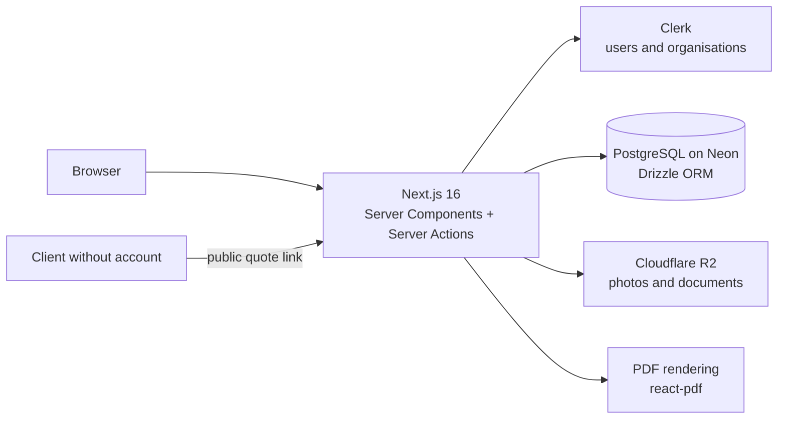

# ServiceFlow

[](https://github.com/anderson-fullstack-developer/serviceflow/actions/workflows/ci.yml)


**Operations software for service businesses.** Electricians, plumbers, cleaning companies and other service providers run the whole job in one place, instead of across WhatsApp, spreadsheets and paper:

```text
Client → Quote → accepted online → Job → Invoice → Payment
```

**Live demo:** [appglobal-sepia.vercel.app](https://appglobal-sepia.vercel.app) (sign up with Google or email)

## Features

- **Clients** with addresses and attached documents
- **Quotes** with line items and a **public link** where the client reviews and accepts the quote online
- **Jobs** with tasks, materials, notes and photos
- **Invoices** generated as **PDF** on the server, and payment tracking
- **Automations** that can be switched on or off per workspace: an accepted quote creates the job, and a completed job creates the invoice
- **Teams** with roles, calendar, task board, inbox and notifications
- **Catalogue** of services, products and materials
- **Global search** across clients, jobs, quotes and invoices (<kbd>Ctrl</kbd> + <kbd>K</kbd>)
- **Reports** per workspace

## Architecture



- **Multi-tenant by design.** Each business is a Clerk organisation mapped to a workspace. Every query for business data goes through `getCurrentWorkspace()` and is filtered by `workspaceId`, so one tenant can never read another's records.
- **Server Actions for mutations**, validated with Zod, with no separate REST layer to keep in sync.
- **Public quote acceptance by token**, so clients approve quotes without creating an account.
- **Versioned schema** with Drizzle migrations (`drizzle/`), covering 21 tables.
- **Role checks on the server**, e.g. only organisation admins can invite team members.

## Tech stack

| Area | Technologies |
|---|---|
| Front-end | Next.js 16 (App Router), React 19, TypeScript, Tailwind CSS, shadcn/ui, React Hook Form |
| Back-end | Server Components, Server Actions, Zod |
| Data | PostgreSQL (Neon), Drizzle ORM |
| Auth | Clerk (users, organisations and roles) |
| Files and documents | Cloudflare R2 (S3 API), `@react-pdf/renderer` |
| Quality | ESLint, strict TypeScript, GitHub Actions |
| Deploy | Vercel |

## Getting started

Requirements: Node.js 20+, pnpm, a PostgreSQL database (Neon works), a Clerk application with Organizations enabled and an R2 bucket.

```bash
pnpm install
cp .env.example .env.local     # database, Clerk and R2 keys
pnpm drizzle-kit migrate       # create the tables
pnpm dev                       # http://localhost:3000
```

```bash
pnpm lint
pnpm typecheck
```

GitHub Actions runs lint and type checking on every push.

## Documentation

Written in Portuguese.

- [Product and technical documentation](docs/DOCUMENTACAO.md): concept, functional spec, data model, multi-tenancy and roadmap
- [Commands](docs/COMANDOS.md)
- [Running costs](docs/CUSTOS.md)

## Author

**Anderson Neto**, Full-Stack Developer in Lisbon. [Portfolio](https://andersonneto.gt.tc) · [LinkedIn](https://linkedin.com/in/anderson-fullstack-developer)

## License

[MIT](LICENSE)
